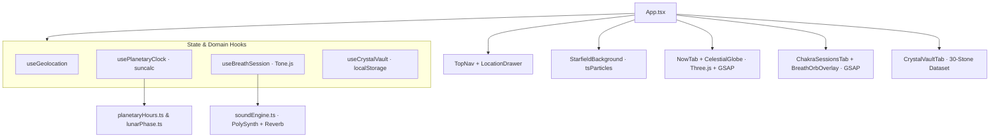

# Astral Hours — Planetary Hours & Crystal Companion


A single-page astronomical practice timer and mineralogical companion combining real-time **Chaldean Planetary Hours**, **Three.js 3D celestial rendering**, **GSAP guided breathwork**, **Tone.js polyphonic singing-bowl drones**, and a scientifically accurate **30-stone Crystal Vault** powered by `suncalc` solar and lunar ephemeris math.

## Features

- **Now (Sky Clock & 3-Minute Practice)**:
  - Computes exact local sunrise, sunset, and next sunrise via `suncalc` using browser Geolocation or manual city/coordinate fallback.
  - Divides daytime and nighttime into 12 unequal solar hours each using the Chaldean order (`Saturn → Jupiter → Mars → Sun → Venus → Mercury → Moon`) starting from the day-ruler at sunrise.
  - Interactive Three.js 3D wireframe celestial globe with meridian rings, 23.4° tilted antique-gold ecliptic ring, star-node constellations, OrbitControls, and a pulsing active planetary ruler node.
  - Optional 3-minute coherence breath session with GSAP breathing guide overlay, Tone.js harmonic singing-bowl drone, and optional Browser Notification hour-change nudges.
  - 24-hour Chaldean progression strip to inspect any daytime or nighttime hour.
- **Chakra Sessions**:
  - Dedicated cards and practice studio for all 7 Chakras (Root `396 Hz` to Crown `963 Hz`).
  - Custom duration selectors (`3`, `5`, `10` min), breath cadences (`Box 4-4-4-4`, `Coherence 5-5`, `Relax 4-7-8`), GSAP visual breath pacer, and polyphonic Tone.js soundscapes with stereo reverb.
- **Crystal Vault**:
  - Scientifically accurate dataset of **30 minerals** with mineral group, Mohs hardness, crystal system, mapped chakra, traditional lore, cleansing method, and water safety ratings (`Safe`, `Caution`, `Unsafe / Toxic`—flagging water-soluble Selenite/Celestite, oxidizing Pyrite, and copper-toxic Malachite/Azurite/Chrysocolla).
  - Dynamic **Moon-Charging Banner** driven by `suncalc.getMoonIllumination` highlighting Full Moon charging and New Moon dry/sound cleansing windows.
  - Search, Chakra & Water Safety filters, `My Collection` toggle, and per-stone personal notes persisted in `localStorage`.

## Architecture



## Getting Started

1. **Install dependencies**

   ```bash
   npm install
   ```

2. **Start development server**

   ```bash
   npm run dev
   ```

3. **Run type-check, tests, and production build**

   ```bash
   npm run lint
   npm test
   npm run build
   ```

## GitHub Pages Deployment

Push to `main` to trigger `.github/workflows/deploy.yml`, which runs type-checking, Vitest unit/integration tests, builds the static bundle with `VITE_BASE_PATH` set to the repository name, and deploys `./dist` to GitHub Pages.
